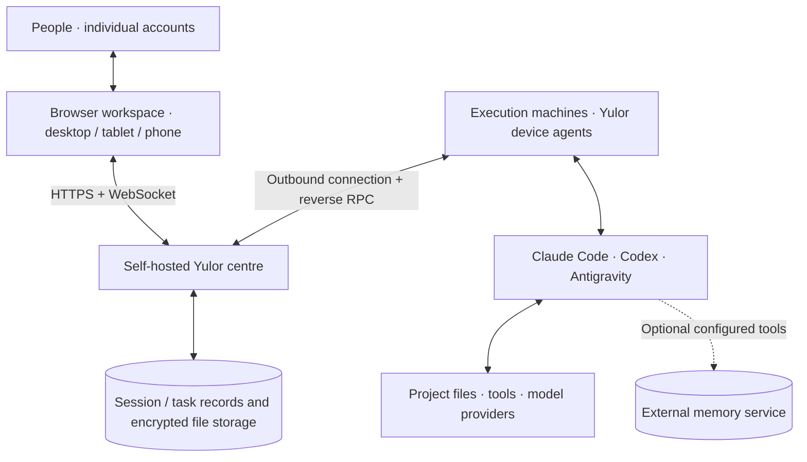

# Yulor · 悠络

<p></p>

> **Formerly LMC / Link my Cli, previously `lmc-workspace` on GitHub.** Same project and history; existing commands and configuration remain compatible. See the [rename and compatibility notes](docs/branding.md).

English · [简体中文](README.zh-CN.md)

**Continue your work across devices. Coordinate your CLI agents in one self-hosted workspace.**

Yulor is a self-hosted workspace for **Claude Code, Codex, and Antigravity**. Start a task at your desk, check progress or reply from your phone, and pick right back up in another browser. Your agents run on your own machines while Yulor links their live sessions, coordinates cross-agent handoffs, and lets you share specific sessions, devices, or files with granular permissions.

[Quick start](#quick-start) · [Why Yulor](#why-yulor) · [How it works](#how-it-works) · [Sharing & privacy](#sharing-and-privacy) · [Documentation](#documentation)


*Actual interface captured before the Yulor rename, populated with synthetic demo content. Agent and model versions shown are illustrative.*

<a id="why-yulor"></a>
<a id="why-lmc"></a>
## Why Yulor

Agent work often fragments across terminal windows, machines, and model providers. Yulor keeps that work connected so you can direct it from anywhere.

| When you need to… | Yulor helps you… |
|---|---|
| Leave the computer where a task started | Reopen the same live session from a phone, tablet, or another computer and keep directing the agent. |
| Use several CLI agents together | Manage Claude Code, Codex, and Antigravity in one workspace, exchange task reports, and hand work between sessions. |
| Run tasks on another machine | Use any lightweight browser to operate agents on a connected macOS, Linux, or Windows execution machine. |
| Collaborate with another person | Share selected sessions, devices, and saved files with specific accounts and fine-grained permissions. |
| Keep personal work private by default | Keep every resource private until explicitly shared, granting collaborators access only to what they need. |
| Avoid repeating task context | Retain session and task records, pass structured handoffs, and optionally connect an external memory service through your CLI's tools. |

For example, start a code change on your desktop workstation, answer a question from your phone, hand the result to another agent for review, and open the delivered report on your laptop. The execution machine must remain available; switching browsers does not move its local files or running processes.

<a id="quick-start"></a>
## Quick start

You need a host for the centre, at least one execution machine, and a browser. The centre and the execution agent can also run on the same machine.

### 1. Deploy your centre

On a host with **Node 22.18+**, **pnpm 10.11** (or Corepack), and **Docker Compose**:

```sh
git clone https://github.com/MoeAisaka/yulor.git
cd yulor
deploy/lmc/up.sh https://lmc.example.com
```

Replace the example origin with your own HTTPS address. The script builds the web app and agent, starts MySQL and the centre, applies database migrations, and prompts you to create your first Yulor account.

The published container port binds only to **127.0.0.1**. Place a TLS reverse proxy such as Caddy, Nginx, or Traefik in front of it with WebSocket forwarding enabled. The script does not configure DNS or expose your centre directly to the internet. See the [deployment guide](deploy/lmc/README.md).

### 2. Connect an execution machine

From a checkout of this repository on each machine where you want to run agents:

```sh
pnpm install
pnpm --filter link-my-cli cli:install

export LMC_HOME_DIR="$HOME/.lmc/agent"
export LMC_SERVER_URL="https://lmc.example.com"
export LMC_WEBAPP_URL="https://lmc.example.com"

yulor auth login
yulor daemon start
```

Approve the device pairing request in your browser. Install and authenticate the CLI engines you plan to use on that execution machine—**Yulor does not replace their provider accounts, subscriptions, or API configuration**. The shell syntax above targets macOS/Linux; on Windows, set the same environment variables in PowerShell or system settings.

### 3. Start work

Open your centre in a browser to launch a session on a connected machine, or start one directly from its terminal:

```sh
yulor                 # Claude Code
yulor codex           # OpenAI Codex
yulor agy             # Google Antigravity
yulor doctor          # Check the agent, engine binaries, and connectivity
```

Sign into your Yulor account from any browser to follow live output, respond to supported interactive prompts, queue follow-up instructions, and collect delivered files.

> `link-my-cli` is not published to the public npm registry—build it from this repository. Running `npm i -g happy` installs the upstream product instead.

<details>
<summary>Updates, additional accounts, and optional configuration</summary>

Re-run `deploy/lmc/up.sh https://lmc.example.com` to update the centre while preserving existing `.env` values. Run `deploy/lmc/up.sh --add-account` to create an additional local sign-in.

| Variable in `deploy/lmc/.env` | Purpose |
|---|---|
| `LMC_PUBLIC_ORIGIN` / `PUBLIC_URL` | Canonical HTTPS browser origin, including any non-standard port. |
| `LMC_MULTI_ACCOUNT_ENABLED=1` | Enable multi-account roles, invitations, and resource sharing. |
| `LMC_FILE_SHARE_ORIGIN` | Optional dedicated origin for expiring external download links. |
| `LMC_TRUSTED_PROXIES` | Reverse-proxy IPs or CIDRs trusted to supply forwarded headers. |

Include the database, file storage, and `LMC_MASTER_KEY` in your backup plan, and store the master key separately from database backups. Review the deployment guide before modifying an existing installation.

</details>

## Work across agents and machines

- **One workspace, multiple engines.** Native wrappers for Claude Code, Codex (`codex app-server`), and Antigravity (`agy`), plus ACP integration for compatible agents. Automatically discover available models and switch only among the modes each engine actually supports.
- **Stay in control mid-task.** Queue follow-up instructions, withdraw queued items, or steer and interrupt active turns where supported by the engine. Interactive cards handle supported clarifying questions, plan approvals, and tool permission requests; availability varies by engine.
- **Coordinate work explicitly.** Dispatch work with controller/worker task assignments, durable agent mail, delivery reports, and review records. Handoffs carry structured task context across sessions, engines, or hosts.
- **See what is running.** Monitor device availability, CPU/memory/disk usage, live session progress, and usage history. Optional quota collectors report provider limits where supported and configured.

Engine controls and resume behavior vary by provider. Cross-engine handoffs pass explicit task context rather than a model's internal hidden state. Moving execution to another host also requires the project files, dependencies, credentials, and permissions to be present on that machine—Yulor does not automatically replicate your working directory.

## Collaborate and deliver

Share a specific **session** with granular permissions (`read`, `send`, `stop`, `approve`, or `configure`), share a **device** for controlled session execution, or share a **saved file** for review. Multi-account collaboration is opt-in; a single-user installation works out of the box.

Agents can publish deliverables using `publish_file`. Saved files remain available through the centre even after the source machine goes offline, complete with browser previews for Markdown, code, images, and PDFs. For external recipients, `share_file` generates explicit, revocable download links with expiration times.

The workspace also provides a built-in web terminal, diff views, one-click Markdown table copying, and responsive layouts for desktop, tablet, and mobile browsers.

<a id="how-it-works"></a>
## How it works


*AI-generated concept illustration, not a product screenshot. The diagram below describes the actual component relationships.*



The **centre** handles identity, permissions, routing, and encrypted persistence. **Execution machines** run the CLI processes and operate on local projects. Because device agents connect outbound to the centre, execution machines require no inbound port forwarding—only the centre needs to be reachable from your browsers and agents.

**Session history, project files, and long-term memory are separate layers.** Yulor retains conversation and task records in the centre, while working files stay on the execution machines. A memory service such as Nowledge Mem is an optional external integration configured through each engine's tool or MCP settings—it is not a bundled database or an automatic copy of every conversation. Sharing a Yulor session never automatically grants access to an external memory service.

For implementation details, see [centre architecture](docs/backend-architecture.md), [CLI architecture](docs/cli-architecture.md), and the [interactive architecture](docs/diagrams/architecture.html), [session-start](docs/diagrams/spawn-session.html), and [encryption](docs/diagrams/encryption.html) diagrams. Download the HTML diagrams to view them locally.

<a id="sharing-and-privacy"></a>
## Sharing and privacy

- **Resource-scoped access.** Sessions, devices, and saved files use explicit sharing policies. Administrator privileges manage the centre itself and do not implicitly grant read access to user content.
- **Client-side content encryption.** Session metadata, messages, runtime state, and file chunks are encrypted on the client before upload. Account root secrets are sealed by the centre's `LMC_MASTER_KEY`, which means the **centre operator is inside the trust boundary**. See [encryption details](docs/encryption.md).
- **Separate external-service boundaries.** CLI model calls and configured tools operate under their own credentials and data policies, and shared memory services require their own user or project access controls. Yulor resource permissions do not provide an OS sandbox or automatically isolate external services.
- **Self-hosted control plane.** Yulor does not depend on Happy's hosted relay or a mandatory mobile app. Upstream hosted voice, push, and telemetry integrations are disconnected; the model providers and external tools you configure remain independent dependencies.

## Compatibility and limits

- **Browser first.** The web workspace is the primary supported client. Native iOS, Android, and Tauri packaging still carries upstream signing identities; distributing native builds requires your own signing configuration.
- **Keep execution machines available.** A browser can disconnect while an agent keeps working. If the execution host sleeps, powers off, or fails, the task cannot continue normally. Persistent records help recovery; they do not guarantee uninterrupted execution.
- **Scope shared services carefully.** Pointing multiple users or agents at a common database or memory endpoint does not mean everyone should read everything. Apply account and project boundaries within each connected system.
- **Compatibility names remain.** Some internal scripts and protocol fields retain `happy` naming, and the legacy `yulor gemini` command is deprecated in favor of `yulor agy`.

<a id="documentation"></a>
## Documentation

| Topic | Guide |
|---|---|
| Install, deploy, and update | [English](deploy/lmc/README.md) · [简体中文](deploy/lmc/README.zh-CN.md) |
| Protocol and session events | [Wire protocol](docs/protocol.md) · [Session protocol](docs/session-protocol.md) |
| Encryption and keys | [Encryption](docs/encryption.md) |
| Centre and scaling | [Backend architecture](docs/backend-architecture.md) · [Multiple processes](docs/multi-process.md) |
| Engines and model discovery | [CLI architecture](docs/cli-architecture.md) · [Model discovery](docs/model-discovery.md) |
| Agent communication and diagnostics | [Reliable mail](docs/reliable-agent-mail.md) · [No-progress diagnostics](docs/engine-no-progress.md) |
| Usage and quotas | [Quota connector](docs/account-quota.md) |
| Contribute or report a problem | [Contributing](docs/CONTRIBUTING.md) · [Issues](https://github.com/MoeAisaka/yulor/issues) |

<details>
<summary>Repository layout</summary>

| Path | Role |
|---|---|
| `packages/lmc-app` | Expo / React Native Web workspace and client-side encryption. |
| `packages/lmc-server` | Fastify + Socket.IO centre, Prisma/MySQL, access policies, and file APIs. |
| `packages/lmc-cli` | Device daemon, engine wrappers, file delivery, orchestration, and mail tools. |
| `packages/lmc-wire` | Shared protocol schemas and contracts. |
| `deploy/lmc` | Docker Compose deployment and upgrade scripts. |
| `packages/codium` | Experimental desktop integration. |

</details>

## Upstream and license

Yulor forked [Happy](https://github.com/slopus/happy) in September 2026 and evolves independently as a self-hosted multi-engine workspace. Upstream components and names remain credited where used.

[MIT](LICENSE).
