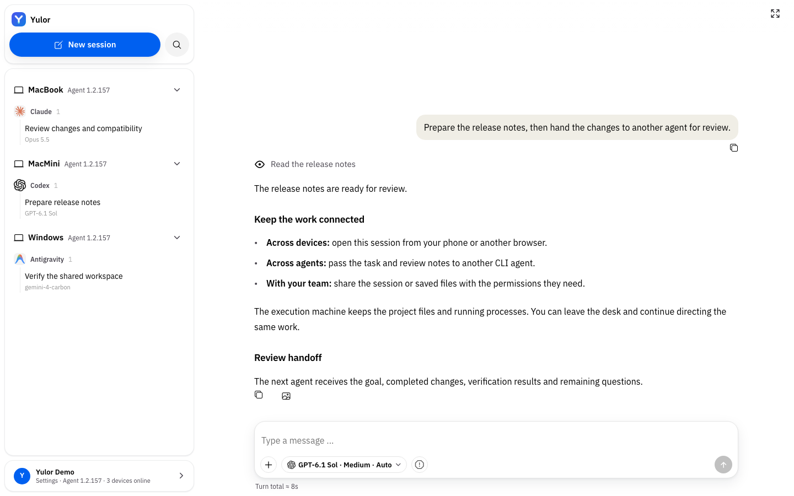
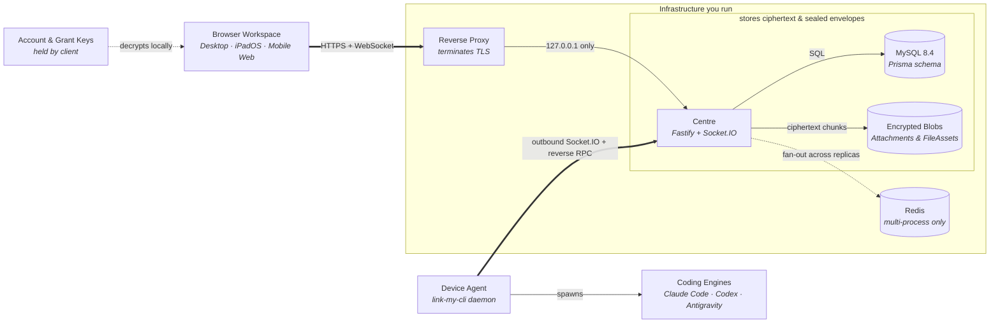
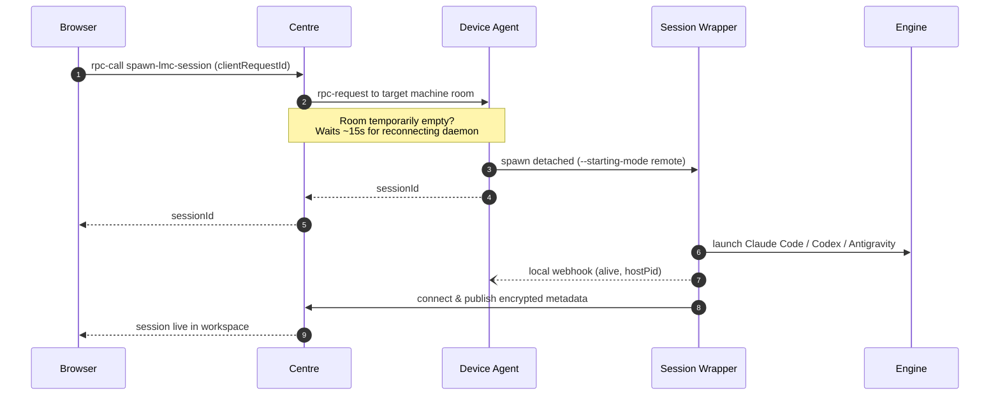
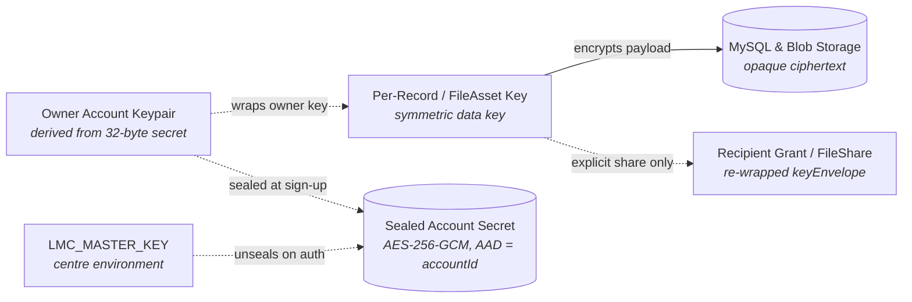

# LMC — Link my Cli

English · [简体中文](README.zh-CN.md)

A self-hosted web workspace for your coding agents. Run **Claude Code**, **OpenAI Codex**, and **Google Antigravity (`agy`)** on your own macOS, Linux, and Windows machines, drive them from any desktop, tablet, or mobile browser, and keep every session, deliverable, and key on infrastructure you control.



*Web workspace with synthetic demo content: manage sessions across devices, follow live agent progress, and queue, steer, or interrupt turns.*

LMC is a self-hosted fork of [Happy](https://github.com/slopus/happy) with zero hosted dependencies: no vendor sign-in, no mandatory mobile app, and no telemetry. You run the centre, and you hold the keys.

---

## Why LMC Exists

Coding agents are normally tied to the terminal where you launched them. Happy solved remote access with a hosted relay; LMC keeps the remote-control model while moving the entire control plane onto your own box — because the transcripts, diffs, and artifacts flowing through it are your source code.

- **Your infrastructure.** One `docker compose` stack (`MySQL 8.4` + `Centre`) bound strictly to `127.0.0.1` behind your own TLS reverse proxy. Redis is optional and only needed when horizontally scaling multiple centre processes.
- **Your accounts.** Local username and `scrypt`-hashed password (`12+` characters) created by you, with `HttpOnly`/`SameSite` session cookies and revocable device pairing. Run single-user by default, or enable multi-account collaboration (`LMC_MULTI_ACCOUNT_ENABLED=1`) with `admin`/`member` roles and invitation links.
- **Your keys.** Session metadata, messages, runtime state, and multi-part files are encrypted client-side before reaching the centre. Account secrets are sealed at rest with `LMC_MASTER_KEY` (AES-256-GCM, `AAD` bound to `accountId`), placing the centre operator — and no one else — inside the trust boundary.

## What It Does

- **Multi-engine sessions** — First-class native control for **Claude Code**, **Codex** (`codex app-server`), and **Antigravity (`agy` / Gemini)**, plus [ACP](https://agentclientprotocol.com)-compatible agents. Supports per-session dynamic model discovery, reasoning effort / thinking budget selection, permission & sandbox modes, and optional **Poe** API routing for Claude with shared point balance tracking.
- **Mid-turn queueing, steering & interactive blocks** — Queue follow-up prompts while an engine is busy, **steer** instructions into an active turn, **interrupt** to run next, or withdraw queued messages. Native structured interactive cards (questions, plan approvals, tool permissions) remain actionable across devices and can be recalled on demand, paired with automatic stall / OS-dialog diagnostics ([`docs/engine-no-progress.md`](docs/engine-no-progress.md)).
- **Outbound device agents** — A lightweight `lmc` daemon on each host dials **outbound** over Socket.IO, so machines running your coding engines require **no inbound ports**. Inspect live CPU, memory, disk, and AI provider network traffic per device, and trigger managed Agent upgrades from the browser without dropping active sessions.
- **Unified encrypted file delivery (`FileAsset` & `FileShare`)** — Agents publish deliverables via MCP (`publish_file`), encrypting chunks client-side into persistent `FileAsset` records with in-browser Markdown, code, image, and PDF preview, inline encrypted Markdown images, and cross-session file delivery. When external delivery is needed, create revocable, expiring (`1–168h`) anonymous download links (`share_file` / `FileShare`) without storing raw tokens or plaintext keys on the server.
- **Multi-agent orchestration, reliable mail & handover** — Dispatch bounded tasks from a controller session to worker sessions across machines (`spawn_worker`, `assign_task`, `await_report`, `report_task`, `review_report`), exchange durable session-to-session mail ([`docs/reliable-agent-mail.md`](docs/reliable-agent-mail.md)), and hand off live sessions across engines or hosts (`submit_handoff`). Sessions are archived **only** on explicit user action.
- **Scoped multi-account sharing** — Share specific **devices** (controlled remote session execution without exposing private sessions, project roots, or raw provider credentials), **sessions** (`read`, `send`, `stop`, `approve`, `configure`), and **saved files** with other accounts on your centre.
- **Usage calendar, quota rings & workspace tools** — Track daily token and spend history on a calendar view, connect an optional local quota collector for Codex / Claude / Antigravity cards and avatar rings ([`docs/account-quota.md`](docs/account-quota.md)), use the embedded web PTY terminal and split/unified diff viewer, copy Markdown tables as rich HTML/TSV or PNG, and run comfortably across desktop, iPadOS (Stage Manager, Magic Keyboard secondary-click, and IME composition), and mobile browsers.

## Architecture



- **Agents dial out**, so developer machines and build hosts never expose inbound ports. The centre invokes RPCs back over the established outbound socket.
- **Payloads arrive pre-encrypted.** Messages, metadata, state snapshots, and multi-part `FileAsset` chunks are encrypted before upload.
- Interactive diagram: [`docs/diagrams/architecture.html`](docs/diagrams/architecture.html) (open locally in a browser).

### Starting a Session on Another Machine



`clientRequestId` makes session creation idempotent across network retries: if a reply times out after the daemon has already spawned the process, retrying returns the existing session instead of starting a duplicate in the same directory. Interactive version: [`docs/diagrams/spawn-session.html`](docs/diagrams/spawn-session.html).

### Key Hierarchy & Sharing Envelopes



Each session, machine, and `FileAsset` has its own symmetric data key. Sharing a session or saved file wraps that resource's data key into a recipient-specific `keyEnvelope` (or a token-derived envelope for an expiring `FileShare` link — where only the SHA-256 token hash is stored server-side). Revoking a share increments `accessVersion` or deletes the share record without exposing the owner's account secret. Full detail: [`docs/encryption.md`](docs/encryption.md) and [`docs/diagrams/encryption.html`](docs/diagrams/encryption.html).

## Quick Start

Requirements: **Node 22.18+**, **pnpm 10.11** (or `corepack`), and **Docker Compose**.

```sh
git clone https://github.com/MoeAisaka/lmc-workspace.git
cd lmc-workspace
deploy/lmc/up.sh https://lmc.example.com
```

`deploy/lmc/up.sh` installs workspace dependencies, builds `lmc-wire`, generates the Prisma client, bundles the device agent, exports the production web app, generates `deploy/lmc/.env` (first run only), starts MySQL 8.4, builds the centre container image, runs database migrations, and prompts you to create your initial sign-in.

Re-run the exact same command to update: `.env` is never overwritten, and the web export is staged beside the live directory before an atomic swap so open browser tabs keep resolving assets cleanly.

```sh
deploy/lmc/up.sh --add-account     # create an additional local sign-in via CLI
```

**Loopback-only by default:** the centre binds its published port to `127.0.0.1`. Place Nginx, Caddy, Traefik, or another TLS reverse proxy in front of `127.0.0.1:${PORT}`, preserving `Host`, `Origin`, and WebSocket `Upgrade` headers.

### Optional Centre Environment (`deploy/lmc/.env`)

| Variable | Purpose |
|---|---|
| `LMC_PUBLIC_ORIGIN` / `PUBLIC_URL` | Canonical browser HTTPS origin (include port if non-standard). |
| `LMC_MULTI_ACCOUNT_ENABLED=1` | Enable multi-account roles (`admin` / `member`), invitations, and resource sharing. |
| `LMC_FILE_SHARE_ORIGIN` | Optional dedicated public origin used when minting expiring `/file-shares/*` links. |
| `LMC_TRUSTED_PROXIES` | Comma-separated proxy IPs/CIDRs trusted to supply `X-Forwarded-Host` / `X-Forwarded-Proto`. |

### Connect a Machine

On each macOS, Linux, or Windows machine where you want to run coding engines:

```sh
pnpm install
pnpm --filter link-my-cli cli:install    # builds, links `lmc`, and refreshes the local daemon
```

Point the agent at your centre (using an isolated `LMC_HOME_DIR` if upstream `happy` is also installed on the host):

```sh
export LMC_HOME_DIR="$HOME/.lmc/agent"
export LMC_SERVER_URL="https://lmc.example.com"
export LMC_WEBAPP_URL="https://lmc.example.com"

lmc auth login      # approve pairing in the browser (revocable from Account Settings)
lmc daemon start    # start background outbound device agent
```

Launch sessions from the browser workspace or directly from a terminal:

```sh
lmc                 # start Claude Code with browser control
lmc codex           # start OpenAI Codex
lmc agy             # start Google Antigravity (agy)
lmc poe             # configure optional Poe API routing for Claude
lmc doctor          # inspect daemon, engine binaries, and connectivity
```

> **Note:** `link-my-cli` is not published to the public npm registry (`npm i -g happy` installs upstream's hosted CLI). Build and link from this repository, or run `node packages/lmc-cli/bin/happy.mjs` directly.

## Repository Layout

| Path | Description |
|---|---|
| [`packages/lmc-app`](packages/lmc-app) | Expo / React Native Web workspace client, responsive desktop/tablet/mobile UI, encryption & sync state. |
| [`packages/lmc-server`](packages/lmc-server) | Fastify + Socket.IO self-hosted centre, Prisma/MySQL schema & migrations, multi-account access & encrypted blob routes. |
| [`packages/lmc-cli`](packages/lmc-cli) | `link-my-cli` (`lmc`) device daemon, engine wrappers (Claude Code, Codex, Antigravity, ACP), MCP server (`publish_file`, `share_file`, orchestration & mail tools). |
| [`packages/lmc-wire`](packages/lmc-wire) | Shared Zod wire schemas, protocol envelopes, file asset/share contracts, and quota calculations. |
| [`deploy/lmc`](deploy/lmc) | One-command Docker Compose deployment, atomic web bundle staging, and migration helpers. |
| [`packages/codium`](packages/codium) | Experimental desktop workbench integration. |

## Documentation

| Topic | Path |
|---|---|
| Deploying & updating the centre | [`deploy/lmc/README.md`](deploy/lmc/README.md) · [`deploy/lmc/README.zh-CN.md`](deploy/lmc/README.zh-CN.md) |
| Wire protocol & session events | [`docs/protocol.md`](docs/protocol.md) · [`docs/session-protocol.md`](docs/session-protocol.md) |
| Encryption boundaries | [`docs/encryption.md`](docs/encryption.md) |
| Centre backend & multi-process scale | [`docs/backend-architecture.md`](docs/backend-architecture.md) · [`docs/multi-process.md`](docs/multi-process.md) |
| CLI, daemon & model discovery | [`docs/cli-architecture.md`](docs/cli-architecture.md) · [`docs/model-discovery.md`](docs/model-discovery.md) |
| Reliable agent mail & stall diagnostics | [`docs/reliable-agent-mail.md`](docs/reliable-agent-mail.md) · [`docs/engine-no-progress.md`](docs/engine-no-progress.md) |
| Account quota connector | [`docs/account-quota.md`](docs/account-quota.md) |
| Contributing | [`docs/CONTRIBUTING.md`](docs/CONTRIBUTING.md) |

## Known Limits

- **Web is the supported primary client.** Native iOS, Android, and Tauri store configurations in the tree still carry upstream's bundle identifiers and signing metadata; shipping native store builds requires replacing those identities with your own developer accounts.
- **The centre operator is inside the trust boundary.** Client-side encryption protects data in transit and in MySQL/blob storage, but `LMC_MASTER_KEY` seals account secrets on the centre. Back up `LMC_MASTER_KEY` separately from your database and never expose it.
- **Hosted voice, push notifications, and paid third-party telemetry SDKs are unwired.** Upstream's hosted integrations were removed rather than pointed at external vendor services.
- **Legacy `happy` compatibility identifiers remain on internal surfaces.** Some internal wire fields, binary entrypoints (`bin/happy.mjs`), encryption salts, and fallback variables retain `happy` naming for protocol compatibility; none of them contact hosted infrastructure.
- **Standalone `lmc gemini` is deprecated.** Upstream's legacy `gemini` CLI wrapper is superseded by first-class Antigravity support (`lmc agy`).

## Relationship to Upstream

LMC forked [`slopus/happy`](https://github.com/slopus/happy) in September 2026 and selectively incorporates upstream fixes while evolving independently as a self-hosted multi-engine, multi-account workspace. Upstream package and product names (`@slopus/*`, Happy Terminal) remain credited where upstream components are used.

## License

MIT. See [LICENSE](LICENSE).
