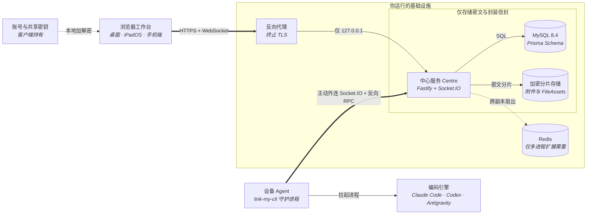
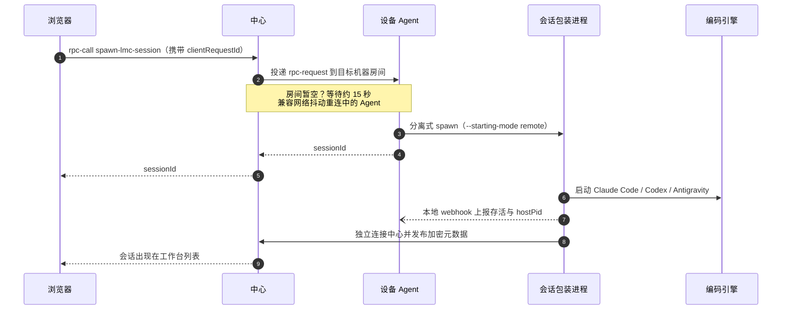
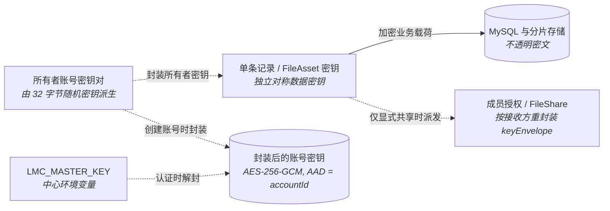

# LMC — Link my Cli

[English](README.md) · 简体中文

面向编码 Agent 的自托管 Web 工作空间。在你自己的 macOS、Linux 与 Windows 机器上运行 **Claude Code**、**OpenAI Codex** 与 **Google Antigravity（`agy`）**，通过桌面、平板（含 iPadOS 台前调度 / 妙控键盘 / 触控）或手机浏览器远程驱动，所有会话、交付文件与密钥始终留在你控制的基础设施内。


*Web 工作空间演示画面（合成示例数据）：跨设备管理会话、查看实时执行进度，并在回合中排队、引导（Steer）或打断（Interrupt）指令。*

LMC 分叉自 [Happy](https://github.com/slopus/happy)，彻底移除了对托管服务的依赖：无需厂商账号登录、无需绑定手机 App、无遥测上报。中心由你运行，密钥归你持有。

---

## 为什么做 LMC

编码 Agent 默认被困在启动它的那台终端里。Happy 用官方托管中继解决了远程控制，而 LMC 保留了远程操控体验，但把整套控制面搬回你自己的服务器或 NAS——因为里面流转的对话、Diff 与产物就是你的源代码。

- **你的基础设施。** 一套 `docker compose` 栈（`MySQL 8.4` + `Centre`），端口仅发布在宿主机 `127.0.0.1` 回环地址上，由你自己的反向代理终止 TLS。Redis 仅在需要多进程水平扩展时才需启用。
- **你的账号与团队权限。** 本地创建用户名与 `scrypt` 哈希口令（至少 12 位），使用 `HttpOnly`/`SameSite` Cookie 与可随时撤销的设备配对。默认单账号即开即用，也可按需开启多账号协作（`LMC_MULTI_ACCOUNT_ENABLED=1`），支持 `admin` / `member` 角色与邀请链接。
- **你的密钥边界。** 会话元数据、消息、运行状态与分片文件均在客户端完成端到端加密后再上传中心；账号根密钥由中心的 `LMC_MASTER_KEY`（AES-256-GCM，`AAD` 绑定 `accountId`）封装保存。**中心运维者在信任边界之内——除此之外没有任何第三方。**

## 核心能力

- **一等公民多引擎控制** —— 原生支持 **Claude Code**、**Codex**（`codex app-server`）与 **Antigravity（`agy` / Gemini）**，同时兼容 [ACP](https://agentclientprotocol.com) 协议 Agent。支持按会话动态发现模型、切换推理强度（Effort / Thinking Budget）与权限/沙箱模式，并支持为 Claude 配置 **Poe** API 路由与共享点数余额展示。
- **回合内排队、实时引导与原生交互卡片** —— 引擎忙碌时可继续发送排队消息，随时选择**引导（Steer）**注入当前回合、**打断（Interrupt）**立即执行或撤回排队项；结构化交互块（多选提问、方案审批、工具授权）跨设备保持可交互并支持按需召回，内置无进展卡顿与系统权限弹窗诊断（[`docs/engine-no-progress.md`](docs/engine-no-progress.md)）。
- **零入站端口的设备 Agent** —— 每台开发机运行轻量 `lmc` 守护进程，主动**向外**通过 Socket.IO 连接中心，开发机无需暴露任何入站端口。支持在网页端实时查看各机器 CPU、内存、磁盘及 AI 服务上下行流量，并支持不断连活动会话的远程平滑升级。
- **统一加密文件投递（`FileAsset` 与 `FileShare`）** —— Agent 可通过 MCP（`publish_file`）交付产物，客户端自动分片加密存储为持久化 `FileAsset`，支持网页端直接预览 Markdown、代码、图片与 PDF、会话内加密渲染 `saved-files` 图片，以及跨会话投递文件；需要对外分享时可生成限时（`1–168` 小时）、可随时撤销的匿名加密下载链接（`share_file` / `FileShare`），服务端不落盘明文密钥或原始 Token。
- **多 Agent 编排、可靠信箱与在线交接** —— 支持主控会话向跨机执行单元派发任务与验收报告（`spawn_worker`、`assign_task`、`await_report`、`report_task`、`review_report`），提供持久化会话间可靠信箱（[`docs/reliable-agent-mail.md`](docs/reliable-agent-mail.md)），并支持跨引擎、跨设备的会话在线交接（`submit_handoff`）。会话仅在用户显式操作时归档，绝不因离线自动隐藏。
- **细粒度多账号资源共享** —— 支持在同一中心内按账号精细共享指定**设备**（受控远程起会话，不暴露设备主人的私有会话、项目目录或本机模型登录凭据）、**会话**（可按 `read` / `send` / `stop` / `approve` / `configure` 授权）与**已保存文件**。
- **用量日历、配额圆环与全端工作台** —— 内置按日 Token/费用统计日历、可选的单源配额看板连接器（展示 Codex / Claude / Antigravity 配额卡片与头像圆环，见 [`docs/account-quota.md`](docs/account-quota.md)）、网页内嵌 PTY 终端、分栏/统一 Diff 视图、Markdown 表格一键复制为富文本表格或 PNG 图片，以及自定义正文字体/代码字体；完整适配桌面端、iPadOS（台前调度、触控板右键菜单、中文输入法组合态）与手机浏览器。

## 架构概览



- **Agent 主动外连**：跑引擎的机器无需公网 IP 或端口映射，中心沿同一条长连接反向发起 RPC 启动会话。
- **数据先加密再离机**：会话记录、状态快照与 `FileAsset` 分片到达中心时已是密文。
- 可交互架构图：[`docs/diagrams/architecture.html`](docs/diagrams/architecture.html)（下载后用本地浏览器打开）。

### 跨设备启动会话流程



`clientRequestId` 保证了网络超时重试的幂等性：如果 Agent 已经拉起进程但回包超时，重试会直接返回同一会话，不会在同一目录重复拉起第二个实例。可交互版本：[`docs/diagrams/spawn-session.html`](docs/diagrams/spawn-session.html)。

### 密钥层级与共享信封



每条会话、机器状态与 `FileAsset` 各自拥有独立的数据密钥。向其他成员共享会话或文件时，仅将该资源的数据密钥重封装为目标成员的 `keyEnvelope`（外链 `FileShare` 则用高熵随机口令封装密钥，服务端仅存口令的 SHA-256 哈希）。撤销共享会立即递增 `accessVersion` 或销毁外链记录，全程不暴露所有者的账号根密钥。详见 [`docs/encryption.md`](docs/encryption.md) 与 [`docs/diagrams/encryption.html`](docs/diagrams/encryption.html)。

## 快速开始

环境要求：**Node 22.18+**、**pnpm 10.11**（或 `corepack`）、**Docker Compose**。

```sh
git clone https://github.com/MoeAisaka/lmc-workspace.git
cd lmc-workspace
deploy/lmc/up.sh https://lmc.example.com
```

`deploy/lmc/up.sh` 会一站式完成依赖安装、构建 `lmc-wire`、生成 Prisma 客户端、打包设备 Agent、导出生产级 Web 静态包、初始化 `deploy/lmc/.env`（仅首次）、拉起 MySQL 8.4、构建中心镜像、执行数据库迁移，并在首次运行时交互式创建首个登录账号。

后续升级直接再次执行同一条命令即可：已有的 `.env` 绝不会被覆盖，Web 静态包会先导出到旁路目录再原子替换，升级期间已打开的浏览器标签页不会白屏或断资源。

```sh
deploy/lmc/up.sh --add-account     # 通过命令行追加本地登录账号
```

**默认仅监听本地回环：** 中心容器端口仅绑定在宿主机 `127.0.0.1`。请使用 Nginx、Caddy 或 Traefik 等反向代理终止 TLS 并转发至 `127.0.0.1:${PORT}`，同时保留 `Host`、`Origin` 与 WebSocket `Upgrade` 请求头。

### 常用中心可选配置（`deploy/lmc/.env`）

| 变量 | 用途 |
|---|---|
| `LMC_PUBLIC_ORIGIN` / `PUBLIC_URL` | 浏览器访问的规范 HTTPS 源（非标准端口需带端口号）。 |
| `LMC_MULTI_ACCOUNT_ENABLED=1` | 开启多账号体系（`admin` / `member` 角色、邀请链接、设备/会话/文件共享）。 |
| `LMC_FILE_SHARE_ORIGIN` | 可选，为限时匿名外链 `/file-shares/*` 指定独立的对外下载域名。 |
| `LMC_TRUSTED_PROXIES` | 受信反向代理 IP 或 CIDR 列表（逗号分隔），用于安全采信 `X-Forwarded-*` 头。 |

### 接入开发机

在任意需要被驱动的 macOS、Linux 或 Windows 机器上构建并安装 CLI：

```sh
pnpm install
pnpm --filter link-my-cli cli:install    # 构建打包、全局链接 `lmc` 并刷新本地守护进程
```

指向你的自托管中心（若机器上同时装有上游 `happy`，建议显式隔离 `LMC_HOME_DIR`）：

```sh
export LMC_HOME_DIR="$HOME/.lmc/agent"
export LMC_SERVER_URL="https://lmc.example.com"
export LMC_WEBAPP_URL="https://lmc.example.com"

lmc auth login      # 在浏览器批准设备配对（可随时在账号设置中撤销）
lmc daemon start    # 启动后台常驻外连守护进程
```

此后即可直接在网页端远程新建会话，或在终端中启动：

```sh
lmc                 # 启动带浏览器协同控制的 Claude Code
lmc codex           # 启动 OpenAI Codex
lmc agy             # 启动 Google Antigravity (agy)
lmc poe             # 配置可选的 Claude Poe API 路由
lmc doctor          # 检查守护进程、引擎可执行文件与连接状态
```

> **提示：** `link-my-cli` 尚未发布至公共 npm 仓库（执行 `npm i -g happy` 安装的是上游托管版包）。请从本仓库构建链接，或直接运行 `node packages/lmc-cli/bin/happy.mjs`。

## 仓库目录结构

| 路径 | 说明 |
|---|---|
| [`packages/lmc-app`](packages/lmc-app) | Expo / React Native Web 客户端工作台，桌面/平板/手机自适应界面、端到端加解密与实时状态同步。 |
| [`packages/lmc-server`](packages/lmc-server) | Fastify + Socket.IO 自托管中心服务、Prisma/MySQL 数据模型与增量迁移、多账号权限与加密分片接口。 |
| [`packages/lmc-cli`](packages/lmc-cli) | `link-my-cli`（`lmc`）设备守护进程、各编码引擎适配器（Claude Code / Codex / Antigravity / ACP）与内置 MCP 服务（`publish_file`、`share_file`、多 Agent 编排与信箱工具）。 |
| [`packages/lmc-wire`](packages/lmc-wire) | 前后端与 CLI 共享的 Zod 协议契约、文件资产/外链结构与配额计算逻辑。 |
| [`deploy/lmc`](deploy/lmc) | 一键 Docker Compose 部署脚本、Web 静态包原子发布与数据迁移工具。 |
| [`packages/codium`](packages/codium) | 实验性桌面端工作台集成。 |

## 延伸文档

| 主题 | 路径 |
|---|---|
| 部署与升级中心 | [`deploy/lmc/README.zh-CN.md`](deploy/lmc/README.zh-CN.md) · [`deploy/lmc/README.md`](deploy/lmc/README.md) |
| 通信协议与会话事件 | [`docs/protocol.md`](docs/protocol.md) · [`docs/session-protocol.md`](docs/session-protocol.md) |
| 加密边界与密钥派生 | [`docs/encryption.md`](docs/encryption.md) |
| 中心架构与多进程扩展 | [`docs/backend-architecture.md`](docs/backend-architecture.md) · [`docs/multi-process.md`](docs/multi-process.md) |
| CLI、守护进程与模型发现 | [`docs/cli-architecture.md`](docs/cli-architecture.md) · [`docs/model-discovery.md`](docs/model-discovery.md) |
| 可靠信箱与卡顿诊断 | [`docs/reliable-agent-mail.md`](docs/reliable-agent-mail.md) · [`docs/engine-no-progress.md`](docs/engine-no-progress.md) |
| 账号配额看板连接器 | [`docs/account-quota.md`](docs/account-quota.md) |
| 参与贡献 | [`docs/CONTRIBUTING.md`](docs/CONTRIBUTING.md) |

## 已知限制

- **Web 客户端是官方支持的主力入口。** 仓库内的原生 iOS、Android 与 Tauri 打包配置仍保留着上游发布方的 Bundle ID 与签名信息；如需自行分发原生客户端，需替换为你自己的开发者账号与证书。
- **中心运维者处于信任边界内。** 客户端加密保护传输链路与数据库/磁盘静态数据，但账号根密钥由中心的 `LMC_MASTER_KEY` 封装保管。备份数据库时请将 `LMC_MASTER_KEY` 分离妥善保存，切勿泄露或随意轮换。
- **托管语音、推送通知与付费第三方遥测 SDK 均已断开。** 上游依赖外部商业服务的集成已被移除，不会向第三方发请求。
- **底层兼容面仍保留部分 `happy` 命名。** 少量内部协议字段、入口脚本名（`bin/happy.mjs`）、加密派生盐值与回退变量为保持协议兼容沿用了 `happy` 前缀，不代表连接任何外部托管服务。
- **独立 `lmc gemini` 子命令已弃用。** 上游旧版 `gemini` CLI 封装已被原生一等公民支持的 Antigravity（`lmc agy`）取代。

## 与上游的关系

LMC 于 2026 年 9 月分叉自 [`slopus/happy`](https://github.com/slopus/happy)，在按需吸收上游底层修复的同时，独立演进为自托管的多引擎、多账号协同工作空间。凡指代上游自身软件与组件的名称（如 `@slopus/*`、Happy Terminal）均保留原有署名。

## 开源许可

MIT，详见 [LICENSE](LICENSE)。
