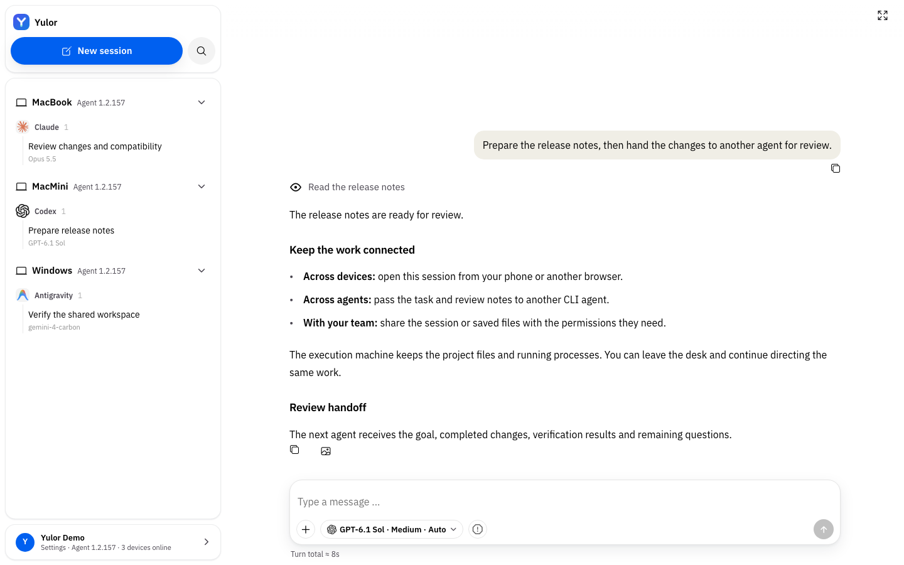
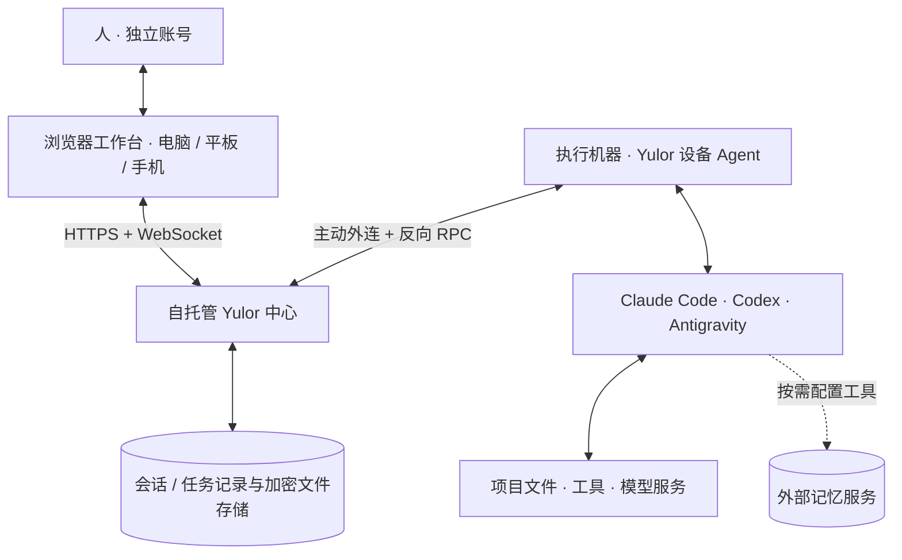

# Yulor · 悠络

<p></p>

> **原名 LMC / Link my Cli，GitHub 仓库旧名 `lmc-workspace`。** 这是同一项目的更名；旧命令与配置继续兼容。详见[更名与兼容说明](docs/branding.md)。

[English](README.md) · 简体中文

**跨终端接续工作，让多个 CLI Agent 在同一自托管工作台协同。**

Yulor 是面向 **Claude Code、Codex 和 Antigravity** 的自托管协作工作台。在桌前启动任务，用手机查看进度或回复询问，再换任意浏览器接着操作。Agent 仍在你自己的机器上运行；Yulor 负责连接跨端会话、编排多 Agent 交接，并支持按细粒度权限向协作者共享指定的会话、设备或文件。

[快速开始](#quick-start) · [为什么用 Yulor](#why-yulor) · [如何工作](#how-it-works) · [共享与隐私](#sharing-and-privacy) · [文档](#documentation)



*更名前的真实工作台界面（使用合成演示内容），用于展示工作台布局，图中标识不代表当前 Agent 或模型版本。*

<a id="why-yulor"></a>
<a id="why-lmc"></a>
## 为什么用 Yulor

Agent 任务常常分散在不同终端窗口、机器和模型服务之间。Yulor 将这些工作连接起来，让你随时随地持续推进。

| 当你需要…… | Yulor 帮你…… |
|---|---|
| 离开启动任务的电脑 | 从手机、平板或另一台电脑重新打开同一实时会话，继续查看输出并下达指令。 |
| 同时使用多种 CLI Agent | 在同一工作台管理 Claude Code、Codex 和 Antigravity，交换任务报告并交接工作。 |
| 在其他机器上运行任务 | 通过任意轻量浏览器远程操作已接入的 macOS、Linux 或 Windows 执行机。 |
| 与他人协同推进 | 向指定账号共享所需的会话、设备或已保存文件，并按操作粒度授予权限。 |
| 默认保持私人空间独立 | 所有资源在显式共享前均保持私有，协作者仅能访问被授权的资源。 |
| 避免反复交代任务背景 | 保留会话与任务记录、传递结构化交接信息，并可按需通过 CLI 工具接入外部共用记忆服务。 |

例如：在桌面工作站上发起代码修改，用手机回答询问，再将改动交接给另一个 Agent 复核，最后在笔记本上打开交付报告。执行机需保持可用；切换浏览器不会迁移本地文件或运行中的进程。

<a id="quick-start"></a>
## 快速开始

你需要一台运行中心服务的主机、至少一台执行机和一个浏览器。中心服务与设备 Agent 也可以运行在同一台机器上。

### 1. 部署中心

在已安装 **Node 22.18+**、**pnpm 10.11**（或 Corepack）和 **Docker Compose** 的主机上执行：

```sh
git clone https://github.com/MoeAisaka/yulor.git
cd yulor
deploy/lmc/up.sh https://lmc.example.com
```

将示例地址替换为你自己的 HTTPS 访问地址。脚本会构建前端应用与 Agent、启动 MySQL 和中心服务、执行数据库迁移，并引导你创建首个 Yulor 账号。

容器发布端口默认仅绑定 **127.0.0.1**。请前置 Caddy、Nginx 或 Traefik 等 TLS 反向代理并开启 WebSocket 转发。脚本不会配置 DNS，也不会直接将中心暴露到公网。详见[部署指南](deploy/lmc/README.zh-CN.md)。

### 2. 接入执行机

在每台需要运行 Agent 的机器上，进入本仓库目录并安装 CLI：

```sh
pnpm install
pnpm --filter link-my-cli cli:install

export LMC_HOME_DIR="$HOME/.lmc/agent"
export LMC_SERVER_URL="https://lmc.example.com"
export LMC_WEBAPP_URL="https://lmc.example.com"

yulor auth login
yulor daemon start
```

在浏览器中批准设备配对请求。请先在执行机上安装并登录所需的 CLI 引擎——**Yulor 不替代模型厂商账号、订阅或 API 配置**。以上命令使用 macOS/Linux Shell 语法；Windows 环境请通过 PowerShell 或系统设置配置同名环境变量。

### 3. 开始工作

在浏览器打开中心即可在已接入的机器上新建会话，也可以直接在执行机终端启动：

```sh
yulor                 # Claude Code
yulor codex           # OpenAI Codex
yulor agy             # Google Antigravity
yulor doctor          # 检查 Agent、引擎可执行文件与连接状态
```

启动后，在任意浏览器登录同一 Yulor 账号，即可实时查看输出、回答已支持的交互提问、排队追加指令并收取交付文件。

> `link-my-cli` 尚未发布到公共 npm 仓库，请从本仓库构建安装；运行 `npm i -g happy` 安装的是上游产品。

<details>
<summary>升级、添加账号与可选配置</summary>

重新运行 `deploy/lmc/up.sh https://lmc.example.com` 即可更新中心服务，已有 `.env` 配置会自动保留。使用 `deploy/lmc/up.sh --add-account` 可新增本地登录账号。

| `deploy/lmc/.env` 中的变量 | 用途 |
|---|---|
| `LMC_PUBLIC_ORIGIN` / `PUBLIC_URL` | 浏览器访问的规范 HTTPS 地址；非标准端口需包含端口号。 |
| `LMC_MULTI_ACCOUNT_ENABLED=1` | 开启多账号角色、邀请与资源共享。 |
| `LMC_FILE_SHARE_ORIGIN` | 可选，为限时外部下载链接指定独立域名。 |
| `LMC_TRUSTED_PROXIES` | 允许提供转发请求头的受信反向代理 IP/CIDR。 |

请将数据库、文件存储与 `LMC_MASTER_KEY` 一并纳入备份计划，并将主密钥与数据库备份分开存放。调整现有部署前请先查阅部署指南。

</details>

## 跨 Agent、跨机器推进

- **一个工作台，多种引擎。** 原生封装 Claude Code、Codex（`codex app-server`）和 Antigravity（`agy`），并提供兼容 Agent 的 ACP 接入。支持动态发现模型，并按各引擎实际支持的能力切换运行模式。
- **任务执行中介入。** 支持排队追加指令、撤回排队项，并在引擎支持时实时引导或打断当前执行。已支持的澄清提问、方案审批和工具授权通过交互卡片处理，具体能力因引擎而异。
- **明确组织多 Agent 协作。** 提供主控/执行节点派单、持久化 Agent 信箱、任务报告与验收记录。跨会话交接可携带结构化任务背景，流转至其他引擎或主机。
- **集中掌握运行与用量。** 查看设备在线状态、CPU/内存/磁盘占用、会话进度与历史用量。可选配的额度采集器支持展示模型厂商额度（取决于厂商接口与配置）。

不同引擎的控制与恢复能力存在差异。跨引擎交接传递的是显式任务背景，不会迁移模型的内部隐藏状态。若将执行切换到另一台主机，目标机器还需具备相应的项目文件、依赖、凭据与权限——Yulor 不会自动复制工作目录。

## 共同协作，交付成果

你可以按细粒度权限（查看、发送、停止、审批或配置）共享指定**会话**，共享**设备**用于受控启动会话，或共享**已保存文件**供他人审阅。多账号协作按需开启，单人部署开箱即用。

Agent 可通过 `publish_file` 交付成果。文件保存在中心服务，来源执行机离线后仍可访问，并支持在浏览器内直接预览 Markdown、代码、图片与 PDF。需要对外分发时，可通过 `share_file` 显式生成带有效期且可随时撤销的下载链接。

工作台还内置网页终端、Diff 视图、Markdown 表格一键复制，以及适配桌面、平板和手机浏览器的响应式布局。

<a id="how-it-works"></a>
## 如何工作


*AI 生成的概念插画，并非产品截图。实际组件关系见下方拓扑图。*



**中心**负责身份认证、权限控制、消息路由和加密持久化；**执行机**运行 CLI 进程并操作本地项目。设备 Agent 通过主动外连接入中心，执行机无需配置入站端口映射，只需确保中心能被浏览器和 Agent 访问。

**会话历史、项目文件与长期记忆分属不同层级。** Yulor 中心保存对话和任务记录，项目工作文件留在执行机本地；Nowledge Mem 等记忆服务属于外部可选接入，通过引擎的工具/MCP 配置使用，并非内置数据库，也不会自动收录每段对话。共享 Yulor 会话不会自动授予外部记忆服务的访问权限。

更多实现细节见[中心架构](docs/backend-architecture.md)、[CLI 架构](docs/cli-architecture.md)，以及可交互的[整体架构](docs/diagrams/architecture.html)、[会话启动](docs/diagrams/spawn-session.html)和[加密关系](docs/diagrams/encryption.html)图。HTML 图可下载到本地查看。

<a id="sharing-and-privacy"></a>
## 共享与隐私

- **按资源粒度授权。** 会话、设备和已保存文件采用显式共享策略。管理员角色仅用于管理中心服务，不会默认获得用户内容的读取权限。
- **内容在客户端加密。** 会话元数据、消息、运行状态与文件分片在上传前均已完成客户端加密。由于账号根密钥由中心的 `LMC_MASTER_KEY` 封装，**中心运维者仍处于信任边界内**。详见[加密说明](docs/encryption.md)。
- **外部服务边界独立。** CLI 模型调用与配置的工具遵循各自的凭据和数据策略，共用记忆库也需单独配置用户或项目访问权限。Yulor 的资源权限不提供操作系统沙箱，也不会自动隔离外部服务。
- **控制面由你自托管。** Yulor 不依赖 Happy 托管中继，也不强制绑定手机 App。上游的托管语音、推送及遥测集成已断开；你自行配置的模型服务和工具仍是独立依赖。

## 兼容性与边界

- **以浏览器端为主。** Web 工作台是主要支持的客户端入口。原生 iOS、Android 和 Tauri 打包配置仍包含上游签名标识，如需自行分发客户端需替换为自有配置。
- **执行机需保持可用。** 浏览器断开时 Agent 仍可继续运行，但若执行机休眠、关机或故障，任务将无法继续执行。持久化记录用于辅助恢复，不保证任务永不中断。
- **共用服务仍需隔离数据。** 多个用户或 Agent 接入同一数据库或记忆服务地址，不代表所有人都应读取全部内容，请在各接入系统中配置账号与项目边界。
- **保留部分兼容命名。** 部分脚本与协议字段仍沿用 `happy` 命名；旧版 `yulor gemini` 命令已废弃，请改用 `yulor agy`。

<a id="documentation"></a>
## 文档

| 主题 | 指南 |
|---|---|
| 安装、部署与升级 | [简体中文](deploy/lmc/README.zh-CN.md) · [English](deploy/lmc/README.md) |
| 协议与会话事件 | [通信协议](docs/protocol.md) · [会话协议](docs/session-protocol.md) |
| 加密与密钥 | [加密说明](docs/encryption.md) |
| 中心与扩展 | [后端架构](docs/backend-architecture.md) · [多进程](docs/multi-process.md) |
| 引擎与模型发现 | [CLI 架构](docs/cli-architecture.md) · [模型发现](docs/model-discovery.md) |
| Agent 通信与诊断 | [可靠信箱](docs/reliable-agent-mail.md) · [无进展诊断](docs/engine-no-progress.md) |
| 用量与额度 | [额度连接器](docs/account-quota.md) |
| 参与贡献或反馈问题 | [贡献指南](docs/CONTRIBUTING.md) · [Issues](https://github.com/MoeAisaka/yulor/issues) |

<details>
<summary>仓库目录</summary>

| 路径 | 职责 |
|---|---|
| `packages/lmc-app` | Expo / React Native Web 工作台与客户端加密。 |
| `packages/lmc-server` | Fastify + Socket.IO 中心、Prisma/MySQL、访问策略和文件接口。 |
| `packages/lmc-cli` | 设备守护进程、引擎封装、文件交付、编排和信箱工具。 |
| `packages/lmc-wire` | 共用协议与数据契约。 |
| `deploy/lmc` | Docker Compose 部署和升级脚本。 |
| `packages/codium` | 实验性桌面端集成。 |

</details>

## 上游与许可

Yulor 于 2026 年 9 月分叉自 [Happy](https://github.com/slopus/happy)，独立演进为自托管多引擎工作台，继续保留所使用上游组件和名称的署名。

[MIT](LICENSE)。
